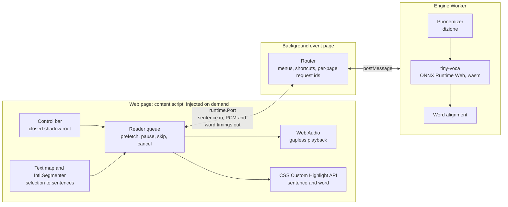

# tiny-reader

A Firefox add-on (Manifest V3) that reads web page text aloud with the
[tiny-voca](https://github.com/n4ze3m/tiny-voca) text-to-speech model and highlights what is
being spoken. Inference runs locally in the browser through ONNX Runtime Web. No text or audio
leaves the machine, and the add-on makes no network requests at runtime.

## Using it

- Select text, right-click, **Read with tiny-voca**. Or press <kbd>Alt</kbd>+<kbd>Shift</kbd>+<kbd>R</kbd>.
- Right-click a paragraph with nothing selected, **Read from here with tiny-voca**: reads from
  the start of that paragraph to the end of the article (`<article>`, `<main>`), or of the page.
- The control bar at the bottom of the page has previous, play/pause, next, speed, voice and stop.
  <kbd>Esc</kbd> stops while the bar has focus.
- Drag the bar by its grip, or by any part that is not a button, to move it. With the grip focused, the arrow keys
  move it too. It stays inside the window and reopens where you left it on that page.
- <kbd>Alt</kbd>+<kbd>Shift</kbd>+<kbd>P</kbd> pauses and resumes, <kbd>Alt</kbd>+<kbd>Shift</kbd>+<kbd>X</kbd>
  stops. Next and previous sentence have commands without default keys. All keys can be changed in
  Firefox under Add-ons and themes → gear menu → Manage Extension Shortcuts.
- Settings (add-on's Preferences): voice, speed, pitch, expressiveness (pitch range) and how many
  sentences are prepared ahead. Speed and voice chosen in the bar are remembered too.

## Requirements

- Node.js 22.18 or newer
- [pnpm](https://pnpm.io/installation) 12 (the exact version is pinned in `package.json`)
- Firefox 140 or newer, desktop

## Setup

```bash
pnpm install
pnpm fetch-assets
```

`pnpm fetch-assets` downloads the model, the phonemizer data and upstream's JavaScript
phonemizer (about 30 MB) into `public/assets/` and `vendor/`. Every file is pinned to a commit
and checked against a SHA-256 in [scripts/fetch-assets.ts](scripts/fetch-assets.ts). These files
are never committed. Running it again only re-verifies what is on disk.

## Development

```bash
pnpm dev
```

Builds in watch mode and starts Firefox with the add-on installed in a temporary profile. It
opens the engine test page (`playground.html`), where you can type a sentence and hear it.

If Firefox is installed as a snap, `web-ext` cannot reach it. Create `web-ext.config.ts`
(gitignored) pointing at the real binary:

```ts
import { defineWebExtConfig } from "wxt";

export default defineWebExtConfig({
  binaries: { firefox: "/snap/firefox/current/usr/lib/firefox/firefox" },
});
```

## Scripts

| Command             | What it does                                                                              |
| ------------------- | ----------------------------------------------------------------------------------------- |
| `pnpm dev`          | Watch build and launch Firefox with the add-on                                            |
| `pnpm build`        | Production build into `.output/firefox-mv3/`                                              |
| `pnpm zip`          | Build and package `.output/tiny-reader-<version>-firefox.zip`, plus a sources zip for AMO |
| `pnpm lint`         | Biome lint and format check                                                               |
| `pnpm format`       | Biome, applying fixes                                                                     |
| `pnpm typecheck`    | `tsc --noEmit` in strict mode                                                             |
| `pnpm test`         | Vitest unit tests                                                                         |
| `pnpm lint:ext`     | `web-ext lint` on the build (run `pnpm build` first)                                      |
| `pnpm fetch-assets` | Download and verify model and phonemizer assets                                           |

`pnpm lint:ext` reports no errors and two accepted warnings:

- `KEY_FIREFOX_ANDROID_UNSUPPORTED_BY_MIN_VERSION`: the add-on is desktop only.
- `UNSAFE_VAR_ASSIGNMENT` in `engine-worker.js`: ONNX Runtime loads its own wasm loader with a
  dynamic `import()`. The URL is always `ort/ort-wasm-simd-threaded.mjs` inside the add-on
  package, an unmodified file from the `onnxruntime-web` npm package.

CI ([.github/workflows/ci.yml](.github/workflows/ci.yml)) runs everything above except
`test:e2e` and uploads the zip as an artifact. The end-to-end tests are left out of CI because
they have only been run locally; set `FIREFOX` to the binary if it is not found.

## Pre-commit hook

[lefthook](https://lefthook.dev) installs a Git pre-commit hook when dependencies are installed (`pnpm install`).
It is configured in [lefthook.yml](lefthook.yml) and runs Biome (lint and formatting) on the staged files; a
finding stops the commit. Fix with `pnpm format`, stage again and commit. `git commit --no-verify` skips it once,
and `pnpm exec lefthook install` reinstalls the hook if it is ever missing.

## Commit messages

Commits use semantic commit messages: `type(scope): subject`, with the scope optional and the subject in the
imperative, lower case, on one line.

| Type                | For                                                  |
| ------------------- | ---------------------------------------------------- |
| `feat`              | A new capability of the add-on                       |
| `fix`               | A bug fix                                            |
| `test`              | Tests only                                           |
| `docs`              | Documentation only                                   |
| `ci`                | The GitHub Actions workflow and Dependabot config    |
| `build`             | Build tooling, asset fetching and dependency bumps   |
| `chore`             | Repository upkeep that fits none of the above        |
| `perf`              | A change that only makes something faster or lighter |
| `refactor`, `style` | Code changes with no change in behaviour; formatting |

Scopes in use: `engine`, `content`, `highlight`, `options`, `e2e`, `parity`, `assets`, `scripts`, `deps`, `dependabot`.
Examples: `feat(engine): align spoken words to source text`, `test(e2e): add reading tests on strict-CSP pages`,
`docs: document the pre-commit hook`.

## Phonemizer parity

Text is turned into phoneme ids by upstream's JavaScript port of the
[dizione](https://github.com/n4ze3m/dizione) phonemizer. `pnpm test:parity` checks that it gives
exactly the ids and stress values of the Python reference for every sentence in
[tests/parity/fixtures.json](tests/parity/fixtures.json).

To regenerate the fixtures (needs `git`, Python 3.10+ and `numpy`):

```bash
python3 scripts/gen-parity-fixtures.py
```

The script checks out dizione at the commit pinned inside it, downloads the phonemizer data at
the pinned Hugging Face revision (SHA-256 verified) into `~/.cache/tiny-reader-parity`, and
phonemizes dizione's own tricky-sentence list plus [tests/parity/extra.txt](tests/parity/extra.txt).
Add sentences to `extra.txt`, not to the JSON.

Two inputs are known to differ on purpose (initials such as "H. C. Sirr": the JavaScript port has
a fix that Python dizione has not published yet). They are listed in `KNOWN_DIVERGENT` in
[tests/parity/parity.test.ts](tests/parity/parity.test.ts) with the recorded JavaScript output,
and a test fails once that list is no longer needed.

## Architecture



- **Content script** ([entrypoints/reader.content.ts](entrypoints/reader.content.ts), [content/](content/)): reads the
  selection from the DOM as one string, splits it into sentences, keeps two sentences synthesized ahead of the one
  playing, and schedules each on the Web Audio clock exactly where the previous one ends. Pause, skip, stop and a
  change of voice or speed abort work that is no longer needed.
- **Highlighting** ([content/text-map.ts](content/text-map.ts), [content/highlight.ts](content/highlight.ts)): offsets
  in that string map back to DOM ranges, which are registered with the CSS Custom Highlight API. Nothing is wrapped or
  inserted. The word highlight follows the audio clock; with `prefers-reduced-motion: reduce` only the sentence is
  marked.
- **Control bar** ([content/bar.ts](content/bar.ts)): a closed shadow root on one host element, the only node the
  add-on adds to a page.
- **Background event page** ([entrypoints/background.ts](entrypoints/background.ts)): context menu, shortcuts and
  message routing. It owns the Worker, because a content script cannot start one, and prefixes request ids per page so
  pages cannot see or cancel each other's requests.
- **Engine Worker** ([entrypoints/engine-worker.ts](entrypoints/engine-worker.ts), [engine/](engine/)): one request is
  one sentence; the reply is 24 kHz PCM plus a time span for every source word. Firefox unloads it 30 seconds after
  reading stops.
- **Protocol** ([engine/protocol.ts](engine/protocol.ts)): typed messages with request ids. Cancelling drops queued
  work and discards the result of work in progress.

The reasoning and measurements behind these choices are in [docs/FINDINGS.md](docs/FINDINGS.md).

## Permissions

| Permission  | Why                                                                                                                                                                                   |
| ----------- | ------------------------------------------------------------------------------------------------------------------------------------------------------------------------------------- |
| `activeTab` | Access to the one tab where you choose **Read with tiny-voca**, only after you do so. This replaces any host permission: the add-on cannot touch pages you have not asked it to read. |
| `scripting` | Injects the reader into that tab on demand (`scripting.executeScript`). No content script is declared for any site.                                                                   |
| `menus`     | Adds **Read with tiny-voca** (on a selection) and **Read from here with tiny-voca** (on the page) to the context menu, and tells the reader which element the menu was opened on.     |
| `storage`   | Remembers your settings (voice, speed, pitch, prefetch depth) in `storage.local`. Nothing else is stored.                                                                             |

There are no host permissions and no `web_accessible_resources`. The extension CSP is
`script-src 'self' 'wasm-unsafe-eval'`: wasm compilation is required by ONNX Runtime, and nothing
else is allowed. The model, ONNX Runtime and the phonemizer run only in the add-on's own Worker,
never in a page, so a page's CSP cannot affect them.

Known limit: text selected inside a frame from another site cannot be read, because `activeTab`
does not extend to such frames.

## Limits

- English only. Text in another script is skipped; if nothing can be read the bar says so. Text
  that Firefox's local language detector identifies as another language gets a warning in the bar
  and is read anyway, with English sounds.
- Text selected inside a frame from another site cannot be read (see Permissions).
- A single "word" that needs more than 200 phoneme tokens and has no space to cut at, such as a
  150-digit number, is left out. Everything around it is read.
- The page does not scroll to follow the highlight.
- With `prefers-reduced-motion: reduce`, only the sentence is highlighted, not each word.
- "Read from here" starts at the beginning of the paragraph, not at the word under the pointer.

## int8 model experiment

```bash
python3 scripts/quantize-experiment.py
```

Needs `onnxruntime`, `onnx` and `numpy`. It writes two dynamically quantized copies of the model
and WAV files for listening into `.output/int8-experiment/`, and prints size, speed and how far
the output drifts from the float32 model. The add-on ships the float32 model; the comparison and
the reasons are in [docs/FINDINGS.md](docs/FINDINGS.md) §14.

## Before publishing

The engine test page (`playground.html`) is part of every build, reachable only by its
`moz-extension://` address. Remove [entrypoints/playground/](entrypoints/playground/) if you do not
want to ship it; `tests/e2e/playground.test.ts` goes with it.

The add-on ID in [wxt.config.ts](wxt.config.ts) (`tiny-reader@tiny-reader.invalid`) is a
placeholder. Change it before submitting to addons.mozilla.org.

## Third-party components

- tiny-voca model and JavaScript phonemizer: Apache-2.0, © Muhammed Nazeem
- Phonemizer dictionary: derived from the CMU Pronouncing Dictionary (BSD-style licence)

The licence texts are bundled in the add-on under `assets/licenses/`.
