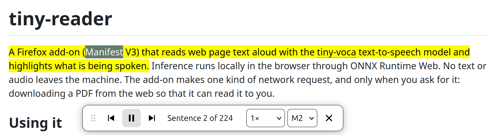
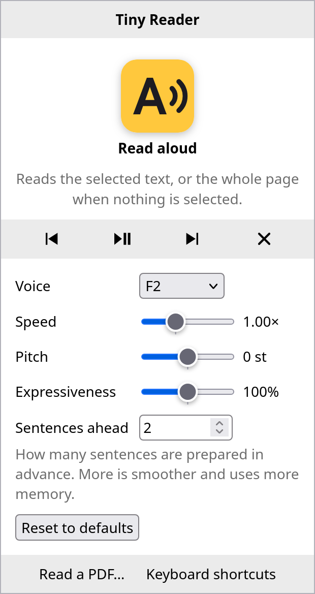
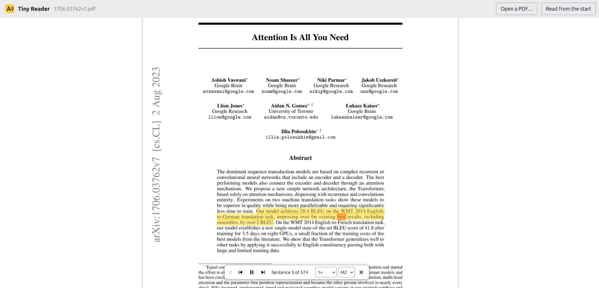

# tiny-reader

A Firefox add-on (Manifest V3) that reads web page text aloud with the
[tiny-voca](https://github.com/n4ze3m/tiny-voca) text-to-speech model, in English and with downloaded models in
eight more languages, and highlights what is
being spoken. Inference runs locally in the browser through ONNX Runtime Web. No text or audio
leaves the machine. The add-on makes two kinds of network request, each only when you ask for it:
downloading a PDF from the web so that it can read it to you, and downloading another voice from
Hugging Face.

<p align="center">
  
</p>

## Using it

- Click the Tiny Reader button in the toolbar and press **Read aloud**: it reads the selection, or the page's main
  text when nothing is selected. The same panel has previous, pause, next and stop, and all the settings.

  <p align="center">
    
  </p>

- To hear a PDF, open the popup and choose **Read a PDF…**. On a PDF tab the popup says so and offers **Open this PDF
  in Tiny Reader…**, and it opens by itself if you try to read the PDF from the context menu or a shortcut. A Tiny
  Reader page opens and shows the PDF's pages as they are. It reads them with the sentence and word highlighted on
  the page, scrolls along as it reads, and has the same control bar, context menu and shortcuts as a web page.
  - A PDF on the web is downloaded and opened for you. The first time for each site, press **Allow and open** and
    accept Firefox's permission prompt; after that, PDFs from that site open at once.
  - A PDF on your computer has to be picked with **Open a PDF…** or dropped on the page: Firefox does not let an
    add-on open a local file by itself. The page names the file to look for.
  - Either way the PDF is processed on your computer and never uploaded.

  <p align="center">
    
  </p>

- Select text, right-click, **Read with tiny-voca**. Or press <kbd>Alt</kbd>+<kbd>Shift</kbd>+<kbd>R</kbd>.
- Right-click a paragraph with nothing selected, **Read from here with tiny-voca**: reads from
  the start of that paragraph to the end of the article (`<article>`, `<main>`), or of the page.
- The control bar at the bottom of the page has previous, play/pause, next, speed, voice and stop.
  <kbd>Esc</kbd> stops while the bar has focus.
- Drag the bar by its grip, or by any part that is not a button, to move it. With the grip focused, the arrow keys
  move it too. It stays inside the window and reopens where you left it on that page.
- <kbd>Alt</kbd>+<kbd>Shift</kbd>+<kbd>P</kbd> pauses and resumes, <kbd>Alt</kbd>+<kbd>Shift</kbd>+<kbd>X</kbd>
  stops. Next and previous sentence have commands without default keys. All keys can be changed in
  Firefox under Add-ons and themes → gear menu → Manage Extension Shortcuts.
- Settings (add-on's Preferences): model, voice, speed, pitch, expressiveness (pitch range) and how many
  sentences are prepared ahead. Speed and voice chosen in the bar are remembered too.
- More voices and languages: the English tiny-voca model with its two voices is built in. Under **More voices** in the
  settings (**Get more voices…** in the popup leads there) you can download others made from it, about 21 MB each:

  | Model                                                                  | Language                       | By                        | Licence    |
  | ---------------------------------------------------------------------- | ------------------------------ | ------------------------- | ---------- |
  | [SobbieTTS](https://huggingface.co/PatnaikAshish/SobbieTTS)            | English                        | PatnaikAshish             | Apache-2.0 |
  | [fiato](https://huggingface.co/cfahlgren1/fiato)                       | English                        | cfahlgren1                | Apache-2.0 |
  | [tiny-voca-ptbr](https://huggingface.co/semfence/tiny-voca-ptbr)       | Brazilian Portuguese           | SemFence (Gustavo Toledo) | CC BY 4.0  |
  | [vocina](https://github.com/OfficinePixel/vocina)                      | Italian                        | OfficinePixel             | Apache-2.0 |
  | [tiny-voca-es](https://huggingface.co/marcosmaceo/tiny-voca-es)        | Spanish (Spain)                | marcosmaceo               | Apache-2.0 |
  | [tiny-voca-fr](https://huggingface.co/DanielSuncost/tiny-voca-fr)      | French                         | DanielSuncost             | Apache-2.0 |
  | [apptor-tiny-tts](https://huggingface.co/apptor/apptor-tiny-tts)       | German                         | apptor                    | Apache-2.0 |
  | [apptor-tiny-tts-at](https://huggingface.co/apptor/apptor-tiny-tts-at) | German with an Austrian accent | apptor                    | Apache-2.0 |
  | [zerre-tts](https://huggingface.co/erkint/zerre-tts)                   | Turkish                        | erkint                    | Apache-2.0 |
  | [tiny-swara](https://huggingface.co/Xeven7/tiny-swara)                 | Bengali                        | Xeven7                    | Apache-2.0 |
  | [tui-voice-mini-ml](https://huggingface.co/Cyrax321/tui-voice-mini-ml) | Malayalam                      | Cyrax321                  | Apache-2.0 |

  Press **Download** and accept Firefox's permission prompt; the file comes from the model's own page, is checked
  against a fingerprint Tiny Reader carries, and is kept on your computer until you press **Delete**. Then choose it
  under **Model**: each model reads one language, and the control bar warns when the page looks like another. Only
  the models in this list can be downloaded: the list is part of the add-on ([engine/models.ts](engine/models.ts)),
  because each language also needs code of its own that has to ship inside it. If a downloaded model is ever
  missing or unusable, the built-in one reads instead and the control bar says so.

## Trying it

Tiny Reader is not on addons.mozilla.org yet. Until it is, build it and load it as a temporary add-on. You need
Node.js 22.18 or newer, [pnpm](https://pnpm.io/installation) 12 and Firefox 140 or newer on desktop.

1. Install the dependencies, download the model (about 30 MB), build eSpeak NG (needs Docker, about a minute) and
   build the add-on:

   ```bash
   pnpm install
   pnpm fetch-assets
   pnpm build-espeak
   pnpm build
   ```

   Without pnpm installed, write `npx -y pnpm@12.21.0` in place of `pnpm`.

2. In Firefox, open `about:debugging#/runtime/this-firefox`.
3. Click **Load Temporary Add-on…** and choose `.output/firefox-mv3/manifest.json` inside this repository. `.output`
   is a hidden folder, so the file picker does not show it: press <kbd>Ctrl</kbd>+<kbd>L</kbd> there and paste the
   full path.
4. The Tiny Reader button appears in the toolbar or in the extensions (puzzle piece) menu, from where it can be
   pinned.

After changing the code, run the build again and click **Reload** on the add-on's card on that page. A temporary
add-on is removed when Firefox closes; load it again after a restart.

## Permissions

| Permission  | Why                                                                                                                                                                                                               |
| ----------- | ----------------------------------------------------------------------------------------------------------------------------------------------------------------------------------------------------------------- |
| `activeTab` | Access to the one tab where you start a reading (toolbar button, context menu or shortcut), only after you do so. This replaces any host permission: the add-on cannot touch pages you have not asked it to read. |
| `scripting` | Injects the reader into that tab on demand (`scripting.executeScript`). No content script is declared for any site.                                                                                               |
| `menus`     | Adds **Read with tiny-voca** (on a selection) and **Read from here with tiny-voca** (on the page) to the context menu, and tells the reader which element the menu was opened on.                                 |
| `storage`   | Remembers your settings (voice, speed, pitch, prefetch depth) in `storage.local`. Nothing else is stored.                                                                                                         |

One optional permission is asked for at runtime, never at install:

| Optional permission                              | Why                                                                                                                                                                                                                                                                                                                                                                                                                                                                                                                  |
| ------------------------------------------------ | -------------------------------------------------------------------------------------------------------------------------------------------------------------------------------------------------------------------------------------------------------------------------------------------------------------------------------------------------------------------------------------------------------------------------------------------------------------------------------------------------------------------- |
| Access to one site (`optional_host_permissions`) | Requested when you open a PDF from that site in the Tiny Reader page, so the add-on can download the file. It is used for that download only; the add-on still injects nothing into the site's pages unless you start a reading there. You can withdraw it under the add-on's Permissions in `about:addons`.                                                                                                                                                                                                         |
| Access to the model's site (the same key)        | `huggingface.co`, or for the Italian model `github.com` and `release-assets.githubusercontent.com`. Requested each time you press **Download** on a voice model, and given back as soon as that download ends (unless you had already granted it for a PDF there). The download would work without it, but then Firefox adds an `Origin` header with the add-on's internal address, which is different for every installation and so could tell yours apart. With the permission the request carries no such header. |

Network requests, all of them started by you:

- A PDF you open from the web, fetched from its own site with the cookies Firefox has for it, as when you view it.
- A voice model you download: one `GET` for a file at a pinned revision on `huggingface.co` (the Italian model: a
  release on `github.com`), which redirects to that site's file servers. No cookies, no data and no header that could tell your installation apart are sent;
  Hugging Face sees what any download shows it, your IP address and browser version. The file is model weights, data that ONNX Runtime
  reads; it is never run as code, and it is stored only if its size and SHA-256 are the ones in the add-on's list.

Nothing is requested in the background, and nothing is updated by itself.

There are no host permissions at install and no `web_accessible_resources`. The extension CSP is
`script-src 'self' 'wasm-unsafe-eval'`: wasm compilation is required by ONNX Runtime, and nothing
else is allowed. The model, ONNX Runtime and the phonemizer run only in the add-on's own Worker,
never in a page, so a page's CSP cannot affect them.

Known limit: text selected inside a frame from another site cannot be read, because `activeTab`
does not extend to such frames.

## Limits

- Nine languages, each with a model of its own: English, Brazilian Portuguese, Italian, Spanish, French, German,
  Turkish, Bengali and Malayalam. All but English have to be downloaded. Text that Firefox's local language
  detector identifies as another language than the model's gets a warning in the bar and is read anyway, with the
  wrong sounds. Text in a script the model cannot read is skipped by the English, Portuguese, Italian and German
  models; the others, which use eSpeak NG, name its letters instead.
- The downloadable models were checked by numbers and against their makers' reference outputs, and the project's
  owner has listened to each of them. For Turkish, Bengali and Malayalam the code that prepares the text is Tiny
  Reader's own port of each project's Python code, which is not in JavaScript; it gives the same output on every
  test sentence. The Malayalam model is called experimental by its makers and has one voice.
- The German download is 34 MB: the voice and a second model that works out how words are pronounced. Its makers
  recommend a further 17 MB sound filter, which Tiny Reader does not use; without it they call the voice clear but
  noticeably buzzy.
- The Austrian model is the German one with an accent, which its makers call mild and an early preview. Its
  strength can be set from 0 to 1.6 in the model; Tiny Reader uses 1.0, the makers' own default, with no setting
  for it. It is a 34 MB download of its own.
- In Spanish, French, Turkish, Bengali and Malayalam, a number, date or amount is highlighted together with the words around it, up to the next
  comma or full stop, not word by word.
- Firefox's Reader View and its PDF viewer cannot be read in place, nor can Firefox's own pages or
  addons.mozilla.org: Firefox lets no add-on into them, whatever its permissions. The toolbar button then shows a "!"
  badge with the reason, and the popup says so. Leave Reader View and read the original page instead. For PDFs, use
  **Read a PDF…**: the highlight is shown on the PDF's pages in Tiny Reader's own page, not in Firefox's viewer.
- What is read from a PDF is rebuilt from the positions of its text, which works for single-column prose. Columns,
  tables, footnotes and running headers may come out in the wrong order, and a scanned PDF (pages stored as pictures)
  is shown but has no text to read. In a scientific paper the running text reads well, but formulas and table cells
  come out as short fragments that are read aloud as they are.
- PDF pages are drawn without pdf.js's extra data files, which are not bundled: text in a font the PDF does not embed
  is drawn in a similar font of your system, and JPEG 2000 and JBIG2 images may be missing. The text is read all the
  same. Links, form fields and comments in a PDF are not shown, and there is no zoom of its own: pages fit the width
  of the window, up to a limit.
- Text selected inside a frame from another site cannot be read (see Permissions).
- A single "word" that needs more than 200 phoneme tokens and has no space to cut at, such as a
  150-digit number, is left out. Everything around it is read.
- The page does not scroll to follow the highlight.
- With `prefers-reduced-motion: reduce`, only the sentence is highlighted, not each word.
- "Read from here" starts at the beginning of the paragraph, not at the word under the pointer.

## More

- [CONTRIBUTING.md](CONTRIBUTING.md): developing, the commands, tests and conventions.
- [docs/ARCHITECTURE.md](docs/ARCHITECTURE.md): how the parts fit together, with a diagram.
- [docs/FINDINGS.md](docs/FINDINGS.md): what was measured and tested, and the decisions that rest on it.

## Licence

GNU General Public License, version 3 or later: see [LICENSE](LICENSE) and [NOTICE](NOTICE). You may use, change and
pass on Tiny Reader, also commercially; if you pass it on, changed or not, it has to be under this same licence,
with its source. The licence follows from eSpeak NG, which is part of the add-on and under the GPL.

## Third-party components

- tiny-voca model and JavaScript phonemizer: Apache-2.0, © Muhammed Nazeem
- Phonemizer dictionary: derived from the CMU Pronouncing Dictionary (BSD-style licence)
- pdf.js (`pdfjs-dist`): Apache-2.0, © Mozilla Foundation. The text-layer rules in
  [entrypoints/document/style.css](entrypoints/document/style.css) are taken from its `pdf_viewer.css`.
- ONNX Runtime Web: MIT, © Microsoft

- Brazilian Portuguese front end (dizione-ptbr in TypeScript): Apache-2.0, © 2026 SemFence (Gustavo Toledo). Its
  lexicon: CC BY 4.0, derived from the Portuguese (Brazil) MFA dictionary by Michael McAuliffe and Morgan Sonderegger
- Italian front end (vocina's `g2p_it`): Apache-2.0, OfficinePixel. Its Wiktionary lexicon: CC BY-SA 4.0, Wiktionary
  contributors
- eSpeak NG 1.52.0, as WebAssembly, for Spanish, French, Turkish, Bengali and Malayalam: GPL-3.0-or-later, © the
  eSpeak NG authors
- Spanish and French front ends (from tiny-voca-es and tiny-voca-fr): Apache-2.0, stdevMac and DanielSuncost
- German front end (from apptor-tiny-tts): Apache-2.0, apptor
- Turkish, Bengali and Malayalam: tables and rules from zerre-tts (erkinemreta1), tiny-swara (Xeven7) and tui-voice
  (Cyrax321), all Apache-2.0, in Tiny Reader's port of their front ends

The models that can be downloaded are not part of the add-on; they are fetched from their makers' pages when you
ask for them, under the licences in the table above. tiny-voca-ptbr is CC BY 4.0: credit SemFence (Gustavo Toledo).

[THIRD-PARTY-NOTICES.md](THIRD-PARTY-NOTICES.md) has the versions and sources. The licence texts are bundled in the
add-on under `licenses/` and `assets/licenses/`.
