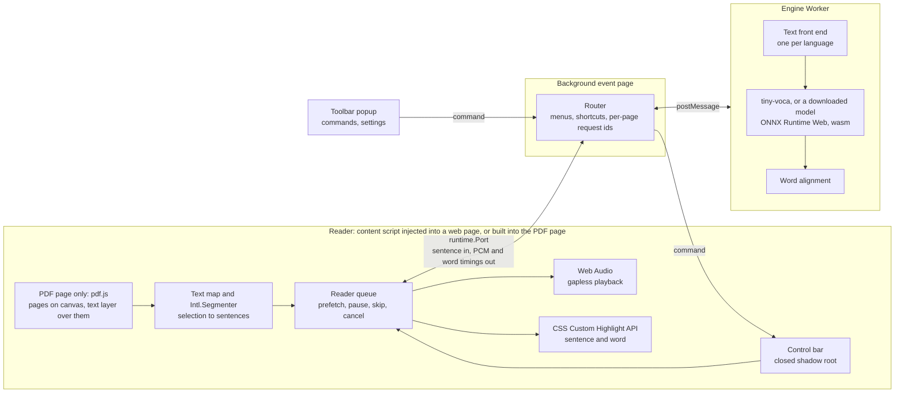

# Architecture

How Tiny Reader is put together: a reader in the page, a router in the background, and the voice in a Worker.

- **Reader** ([content/controller.ts](../content/controller.ts), [content/](../content/)): reads the selection from the DOM
  as one string, splits it into sentences, keeps two sentences synthesized ahead of the one playing, and schedules
  each on the Web Audio clock exactly where the previous one ends. Pause, skip, stop and a change of voice or speed
  abort work that is no longer needed. It runs in web pages as a content script
  ([entrypoints/reader.content.ts](../entrypoints/reader.content.ts)), injected on demand, and is built into the
  document page.
- **Highlighting** ([content/text-map.ts](../content/text-map.ts), [content/highlight.ts](../content/highlight.ts)): offsets
  in that string map back to DOM ranges, which are registered with the CSS Custom Highlight API. Nothing is wrapped or
  inserted. The word highlight follows the audio clock; with `prefers-reduced-motion: reduce` only the sentence is
  marked.
- **Control bar** ([content/bar.ts](../content/bar.ts)): a closed shadow root on one host element, the only node the
  add-on adds to a page.
- **Document page** ([entrypoints/document/](../entrypoints/document/), [content/pdf-text.ts](../content/pdf-text.ts)): a
  page of the add-on's own that shows a PDF you open with a bundled copy of pdf.js: each page drawn on a canvas, with
  pdf.js's invisible text layer over it. Paragraphs are rebuilt from the positioned text runs, with a map from every
  word back to its place in the text layer, so the same controller as the content script
  ([content/controller.ts](../content/controller.ts)) reads them and the highlight lands on the page.
- **Toolbar popup** ([entrypoints/popup/](../entrypoints/popup/)): the panel behind the toolbar button. Its buttons send
  a command to the background, which passes it to the reader in the active tab; its settings form is the one the
  options page uses ([content/settings-form.ts](../content/settings-form.ts)).
- **Background event page** ([entrypoints/background.ts](../entrypoints/background.ts)): context menu, shortcuts and
  message routing. It owns the Worker, because a content script cannot start one, and prefixes request ids per page so
  pages cannot see or cancel each other's requests. It also tells the popup whether the active tab can be read, and
  opens the popup when a reading could not start.
- **Engine Worker** ([entrypoints/engine-worker.ts](../entrypoints/engine-worker.ts), [engine/](../engine/)): one request is
  one sentence; the reply is 24 kHz PCM plus a time span for every source word. Firefox unloads it 30 seconds after
  reading stops.
- **Front ends** ([engine/frontends.ts](../engine/frontends.ts)): text to phoneme tokens, one per language: English
  (dizione), Brazilian Portuguese (dizione-ptbr), Italian (vocina's `g2p_it`), German (apptor's, with a
  letter-to-sound model that is downloaded with the voice), and for Spanish and French each model's own code around
  eSpeak NG, which runs as WebAssembly ([engine/espeak.ts](../engine/espeak.ts)). Their
  code is in the package; each model names the one it needs, and a front end is set up the first time a model asks
  for it.
- **Models** ([engine/models.ts](../engine/models.ts), [engine/model-store.ts](../engine/model-store.ts),
  [engine/loader.ts](../engine/loader.ts)): the list of models the add-on can use. The first ships in the package;
  the others are downloaded from the settings page, verified against the list and kept in IndexedDB, where the
  Worker finds them. Each request names its model, and the Worker falls back to the bundled one, with a notice for
  the control bar, when a downloaded model is missing or unusable.
- **Protocol** ([engine/protocol.ts](../engine/protocol.ts)): typed messages with request ids. Cancelling drops queued
  work and discards the result of work in progress.

The reasoning and measurements behind these choices are in [docs/FINDINGS.md](FINDINGS.md).
